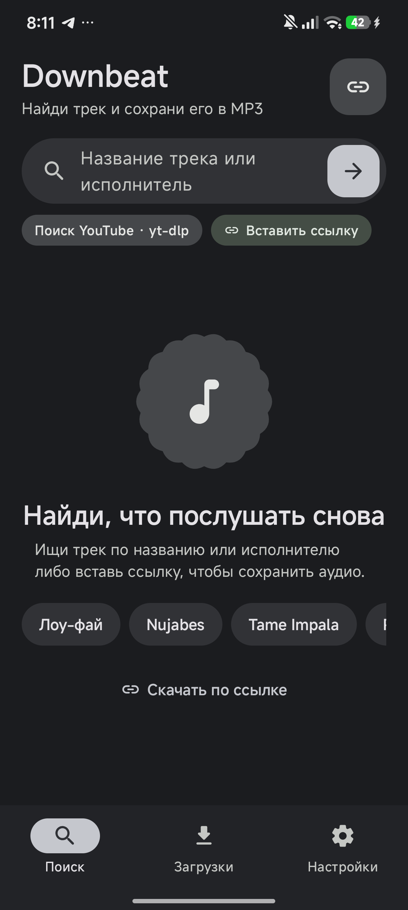
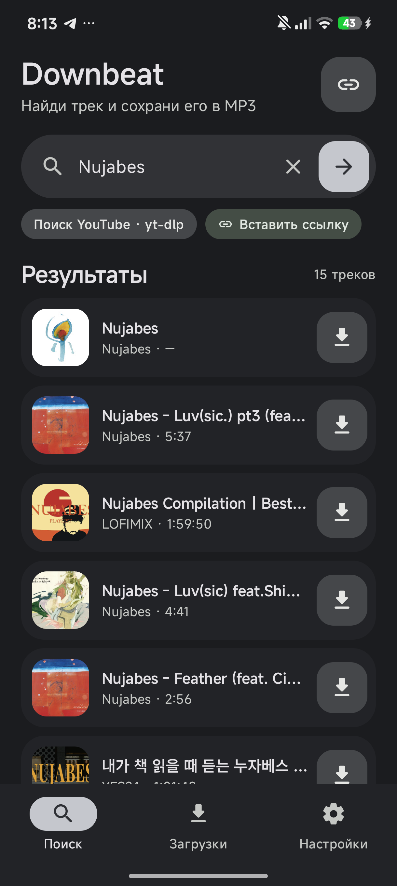

# Downbeat

A small Android app that finds a song by its title and keeps it as an MP3. It searches
YouTube through [yt-dlp](https://github.com/yt-dlp/yt-dlp), converts the audio with ffmpeg,
and publishes the result to `Music/Downbeat` so it shows up in any music player.

The UI follows the Material 3 Expressive direction: big touch targets, varied round shapes
(scalloped "cookie" artwork, pill search field, squircles), bold type and a wavy progress
indicator instead of a plain linear bar.

<p align="center">
  
  
</p>

## Features

- **Search by title or artist** — results come from a `ytsearch` query handled by yt-dlp.
- **One-tap MP3** — the best audio stream is extracted and converted to MP3 (V0) with ffmpeg.
- **Download from a link** — paste any URL supported by yt-dlp, or share a link into the app
  from a browser. Direct audio URLs are streamed without the engine.
- **Visible in music apps** — files are published through MediaStore to `Music/Downbeat`
  (legacy path on Android 9 and older).
- **Fallback on failure** — if a direct download fails, the source link stays in the list with
  Retry / Open link / Copy link actions.
- **Download history** — completed downloads survive restarts.
- **Languages** — System / English / Русский, switchable inside the app.
- **Themes** — Graphite, Sand and Ocean, each with light and dark variants.
- **Cancellable downloads** — removing an item also stops the underlying yt-dlp process.
- **Background engine init** — yt-dlp and ffmpeg are prepared off the main thread.

## Download

Grab the APK from [Releases](../../releases/latest):

| File | Target |
| --- | --- |
| `Downbeat-*-arm64-v8a.apk` | Phones and tablets (almost all modern devices) |
| `Downbeat-*-x86_64.apk` | Emulators |
| `Downbeat-*-sources.zip` | Full source tree |

Requires Android 7.0 (API 24) or newer.

## Build

Requirements: JDK 17+ (21 works), Android SDK with platform 35.

```bash
git clone https://github.com/HELFZz/downbeat.git
cd downbeat
echo "sdk.dir=/path/to/Android/Sdk" > local.properties
./gradlew :app:assembleDebug
```

APKs appear in `app/build/outputs/apk/debug/`. The Gradle wrapper is included, so a local
Gradle installation is not needed.

Release builds are signed with the local debug keystore so the published APKs can be
installed directly. This is a hobby project, not a Play Store distribution.

Checks:

```bash
./gradlew :app:testDebugUnitTest :app:lintDebug
```

## Tech stack

- Kotlin, Jetpack Compose, Material 3
- [youtubedl-android](https://github.com/yausername/youtubedl-android) (yt-dlp + ffmpeg, Python bundled)
- OkHttp for direct audio URLs, Coil for artwork
- kotlinx.serialization, kotlinx.coroutines
- DataStore-free settings on SharedPreferences

## Project layout

```
app/src/main/java/com/downloader/app
├── data/          engine wrapper, search parser, storage, history, settings, ViewModel
├── i18n/          English and Russian strings
└── ui/            Compose screens, components and themes
```

## Disclaimer

Downbeat is a personal downloader. Only download content you own or are allowed to download.
Respect the terms of service of the sites you use and the rights of the authors. The app is
not affiliated with YouTube, yt-dlp or Google.
